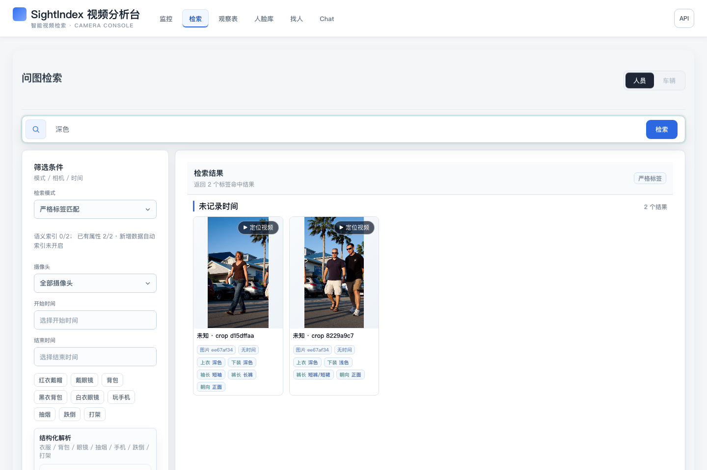
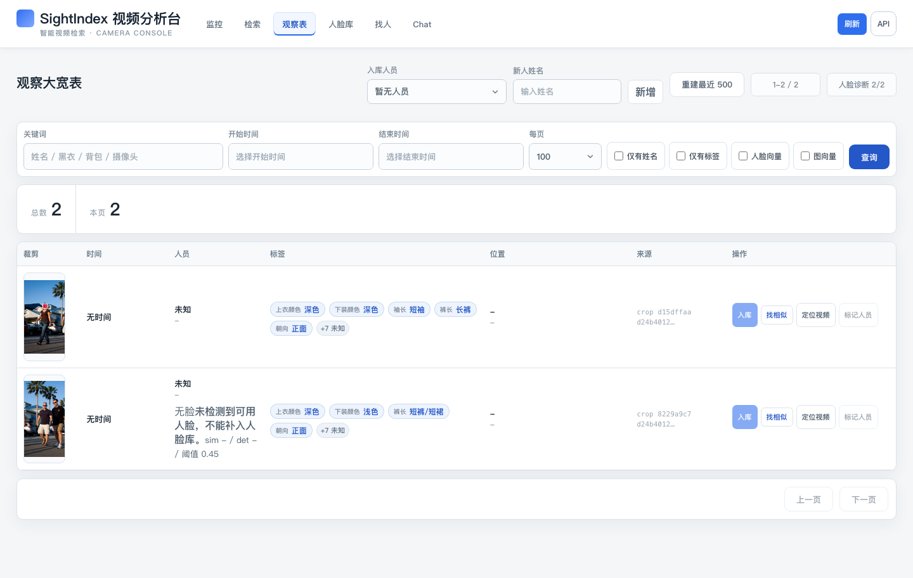

# SightIndex console tour

[English](showcase.md) · [简体中文](showcase.zh-CN.md) · [Project](../README.md)

A short, reproducible path through the actual console: upload a public image, inspect the detected
crops, then filter the labels already stored on those crops. No external model service is needed
for this path.

## Find the available evidence



The query `深色` (“dark clothing”) uses **strict label matching**. The console returns two crop
records with a stored dark-clothing label. The sidebar shows semantic index coverage **0/2**:
these are label matches, not embedding matches or identity matches. The displayed scores are
search scores, not probabilities or accuracy figures. The current console UI is Chinese.

## Inspect the records



Open **观察表** (Observations) at `/observations`. The table connects a crop to its image record,
available labels and source information. Unknown identity and missing capture time remain
unknown; this walkthrough does not register people or infer their names.

For uploaded video, **定位视频** (Locate video) opens the source at its stored offset. This sample
is a still photograph, so there is no source video. This tour does not demonstrate live cameras,
counting, semantic retrieval, face matching or cross-camera ReID.

## Try it locally

1. Follow the [quick start](../README.md#quick-start), including copying `.env.example`.
2. With the API running, execute from the repository root:

   ```bash
   .venv/bin/python scripts/demo_walkthrough.py
   ```

   For another port, add `--base-url http://127.0.0.1:8876`. If Basic Auth is enabled, add
   `--username YOUR_LOCAL_USERNAME`; the script prompts for the password without echoing it.

3. Open `http://127.0.0.1:8000/observations` and compare the crops with
   [`samples/nasa-walk.jpg`](../samples/nasa-walk.jpg).
4. Open `/search` (**检索**), choose **严格标签匹配** (Strict label matching), enter `深色`, and
   click **检索**. It can only match labels present in your processed data.

Each run adds one new image. The script checks health, upload, detection, the stored image,
crop downloads and retry reuse. It leaves your existing data intact. It does not configure or
call external AI services, download weights or start cameras. Use it only against an instance
you control. To inspect the individual requests, see [First run](first-run.md).

## What the default setup demonstrates

| Path | What to expect |
| --- | --- |
| Upload → process → inspect | SQLite metadata, HOG detections, crop files and source links |
| Basic appearance → strict labels | CV tone labels when available; lighting and crop quality affect them |
| Rich structured attributes | Require a configured VLM and crop analysis; missing fields do not match |
| Free-text semantic retrieval | Requires embeddings, Milvus and an indexed collection |
| Cross-camera candidates | Requires the optional ReID service, its weights and index; human verification remains necessary |

## Capture and sample notes

Captured on **2026-11-02**, from source baseline `523f7aa` with the observation-table mobile width
fix included in this change. Configuration: SQLite, `PERSON_DETECTOR=hog`, `HOG_HIT_THRESHOLD=0.5`,
OpenCV 4.11.0, `APPEARANCE_TONE_ON_INGEST=true`; Milvus, VLM, semantic search, face recognition on
ingest and ReID disabled. Screenshots are direct Chromium captures of the running Vue console,
not design mockups. No customer footage or private camera endpoints are used.

The public photograph contains four people; this HOG run returned two detector boxes and missed
people. Crop padding also includes nearby people. This illustrates why a crop or a returned count
must be checked against the original frame. It is not a detection benchmark or a curated success
case. Different detector/version settings may produce different results.

The image credit, source revision, modifications and rights statement are in
[the sample README](../samples/README.md). The sample is not an identity dataset and implies no
endorsement by NASA or the people pictured. Original project code and optional third-party model
components have different terms; see [LICENSE_SCOPE.md](../LICENSE_SCOPE.md).
