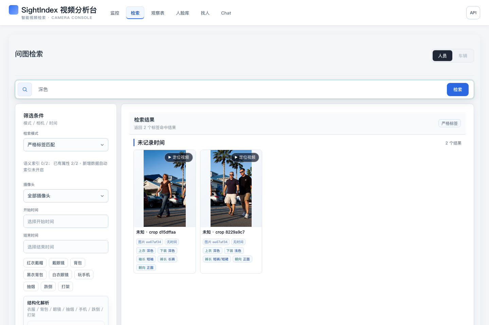
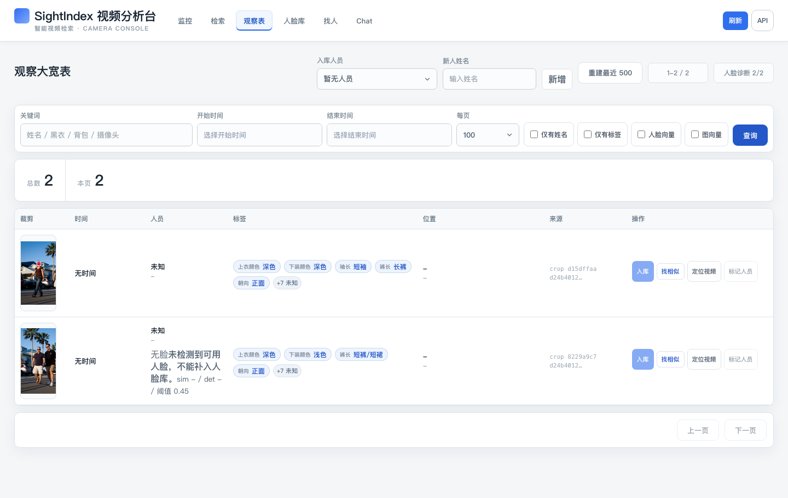

# SightIndex 实际界面与样例

[English](showcase.md) · [简体中文](showcase.zh-CN.md) · [项目首页](../README.zh-CN.md)

用一张公开图片走一遍实际流程：上传素材、查看检测裁剪、按已有标签检索。这条流程不需要外部模型服务。

## 从已有记录里找画面



输入“深色”，选择**严格标签匹配**，返回两条已经存有深色衣服标签的裁剪记录。
左侧明确显示“语义索引 0/2”：这里没有使用 embedding 或进行身份匹配。
界面分数用于检索排序，不是准确率，也不是身份概率。

## 对照裁剪、标签和来源



打开 `/observations` 的**观察表**，查看人员裁剪、已有标签和所属图片记录。
未标记身份的人员仍显示未知，上传图片没有拍摄时间就不补造时间。样例不会把照片中人物的姓名关联到裁剪图。

视频生成的记录可以点**定位视频**，按保存的时间偏移打开源视频。这次素材是静态照片，没有源视频可播放。
这组截图不展示实时摄像头、计数、语义检索、人脸匹配或跨摄像头 ReID 效果。

## 本地体验

1. 按[快速开始](../README.zh-CN.md#快速开始)启动服务，包括复制 `.env.example`。
2. 在仓库根目录执行：

   ```bash
   .venv/bin/python scripts/demo_walkthrough.py
   ```

   使用其他端口时，加 `--base-url http://127.0.0.1:8876`。
   启用了 Basic Auth 时，加 `--username YOUR_LOCAL_USERNAME`，脚本会单独提示输入密码，不回显密码。

3. 打开 `http://127.0.0.1:8000/observations`，将裁剪与
   [`samples/nasa-walk.jpg`](../samples/nasa-walk.jpg) 原图对照。
4. 打开 `/search` 的**检索**页，选择**严格标签匹配**，输入“深色”后点**检索**。
   结果取决于实际已存储的标签，缺失的标签不会命中。

每次执行会新增一张图片。脚本依次检查健康状态、上传、检测、素材记录、裁剪文件可访问性，以及重复处理是否复用原裁剪。
不清空已有数据，不配置或调用外部 AI 服务，不下载模型，不启动摄像头。仅在自己可控制的实例上运行。
逐条 API 操作见[首次体验指南](first-run.zh-CN.md)。

## 默认能体验什么，还要配置什么

| 流程 | 所需条件 |
| --- | --- |
| 上传 → 处理 → 查看 | SQLite、HOG 人员检测、裁剪文件与来源记录 |
| 基础外观 → 标签匹配 | CV 色调处理产生的已有标签；受光照与裁剪质量影响 |
| 更丰富的结构化属性 | 配置 VLM 并分析裁剪，未解析的字段不能命中 |
| 自由文字语义检索 | embedding、Milvus 与已建立的索引 |
| 跨摄像头人员候选 | 可选 ReID 服务、对应权重和索引；结果需人工核验 |

## 截图版本与素材说明

截图日期 **2026-11-02**，基于源码 `523f7aa`，包含本次观察表手机宽度修正。
配置为 SQLite、`PERSON_DETECTOR=hog`、`HOG_HIT_THRESHOLD=0.5`、OpenCV 4.11.0、
`APPEARANCE_TONE_ON_INGEST=true`；关闭 Milvus、VLM、语义检索、入库人脸识别和 ReID。
截图直接来自运行中的 Vue 控制台，不是界面设计稿，不包含客户画面或私人摄像头地址。

原图有四个人，这次 HOG 返回了两个检测框，存在漏检；裁剪扩边也会带入旁边的人。
因此，裁剪结果与数量都应回到原始画面核对。这是操作流程示例，不是检测基准或筛选后的成功案例。
不同检测器与版本的结果可能不同。

照片来源、版本、处理方式和权利声明见[样例说明](../samples/README.md)。不以这张照片验证身份，
也不表示 NASA 或照片中人物认可本项目。项目原创代码和可选第三方模型组件的授权范围不同，见
[LICENSE_SCOPE.md](../LICENSE_SCOPE.md)。
